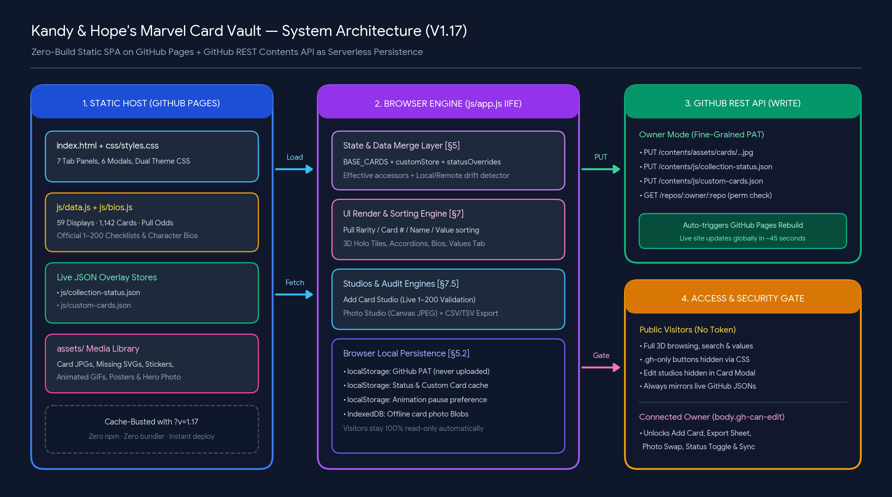
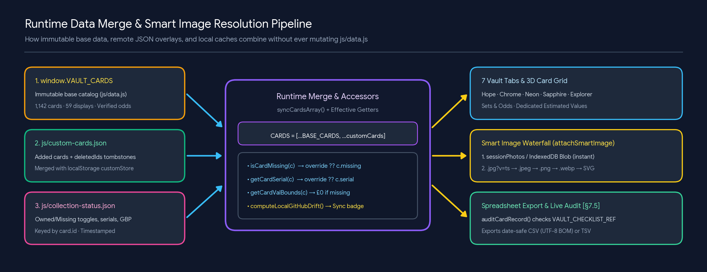
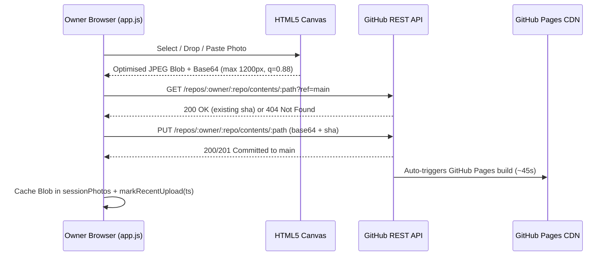

# Kandy & Hope's Marvel Card Vault — Code-Level Project Design Document

**Current Version:** `V1.18`  
**Audience:** Junior Developers & Maintainers  
**Hosting:** GitHub Pages (Zero-Build Static SPA)  
**Cross-Reference Convention:** Every code file (`index.html`, `css/styles.css`, `js/app.js`, `js/data.js`, `js/bios.js`) contains inline **`[DOC §X.Y]`** comment tags that map directly to the sections in this document. Press `Ctrl+Shift+F` in VS Code and search `[DOC §` to jump straight between documentation and code.

---

## Table of Contents
1. [§1. Project Overview & Architectural Philosophy](#1-project-overview--architectural-philosophy)
2. [§2. Technology Stack, Browser APIs & Best Practices](#2-technology-stack-browser-apis--best-practices)
3. [§3. Repository Hierarchy & File Breakdown](#3-repository-hierarchy--file-breakdown)
4. [§4. Data Architecture & Schemas (`js/data.js`, `js/bios.js` & JSON Overlays)](#4-data-architecture--schemas-jsdatajs-jsbiosjs--json-overlays)
5. [§5. Application State, Persistence & Drift Sync (`js/app.js`)](#5-application-state-persistence--drift-sync-jsappjs)
6. [§6. GitHub Direct Sync & Media Pipeline (`js/app.js`)](#6-github-direct-sync--media-pipeline-jsappjs)
7. [§7. Rendering Engine, Sorting & Interactive Studios (`index.html` + `js/app.js`)](#7-rendering-engine-sorting--interactive-studios-indexhtml--jsappjs)
8. [§8. Styling & Visual Design System (`css/styles.css`)](#8-styling--visual-design-system-cssstylescss)
9. [§9. Junior Developer Maintenance Playbook & Troubleshooting](#9-junior-developer-maintenance-playbook--troubleshooting)

---

## §1. Project Overview & Architectural Philosophy



### §1.1 What the Application Does
**Kandy & Hope's Marvel Card Vault** is an interactive, responsive collector showcase and inventory management Single-Page Application (SPA) tracking **2026 Topps Chrome Marvel Comics**, **2026 Topps Neon Marvel**, and **2026 Topps Chrome Sapphire Marvel Comics** cards across two personal collections:

* **🌈 Hope's Rainbow Room (`panel-hope`):** Tracks Hope's complete 48-parallel Chrome rainbows for **Moon Girl (`#138`)** and **Devil Dinosaur (`#110`)**, collapsible comic-book character biographies (`js/bios.js`), and her bonus Sapphire/Neon cards (`D6`).
* **🏆 Kandy's Chrome Vault (`panel-chrome`):** Displays Kandy's numbered Chrome base parallels (`D3`) up front, followed by **29 collapsible insert, autograph & sketch sets** (`D101–D129`).
* **⚡ Kandy's Neon Vault (`panel-neon`):** Displays Kandy's numbered Neon base & Chrome Neon Etch parallels (`D5`) up front, followed by **18 collapsible insert, variation & sketch sets** (`D201–D218`).
* **💎 Kandy's Sapphire Vault (`panel-sapphire`):** Displays Kandy's numbered Sapphire base parallels (`D7`) up front, followed by **6 collapsible Sapphire insert & facsimile autograph sets** (`D301–D306`).
* **🔎 Vault Explorer (`panel-explorer`):** Global search, multi-filter (Owner, Section, Set, Sort), and quick-tag chips (`ACE Slabs`, `/5 & /10 Ultra Rares`, `Autographs`, `Case Hits`, `Alpha #1 & Bookends`, `Missing`).
* **📚 Sets, Checklists & Odds (`panel-sets`):** Official release summaries, published pull-odds comparison table, and active chase tracker (intentionally free of GBP prices).
* **💷 Estimated Values (`panel-values`):** Dedicated valuation dashboard (the **only** place GBP estimates are displayed) with Low/Mid/High switcher, owner filter (`Together` / `Kandy` / `Hope`), section breakdown table, and ranked descending card list.

### §1.2 Why It Was Designed This Way
| Architectural Decision | Why We Chose It | Trade-Off / Benefit for Maintainers |
| :--- | :--- | :--- |
| **Zero-Build Vanilla HTML/CSS/JS** | No React, Webpack, Vite, or `node_modules` required. | Double-clicking `index.html` or pushing to GitHub works immediately with zero dependency rot or broken builds. |
| **GitHub Pages + GitHub REST Contents API** | Free static hosting with serverless write capability for the vault owner. | No backend server or database to pay for or patch. GitHub acts as both the CDN and the version-controlled database. |
| **Immutable Base Data + JSON Overlay Pattern** | `js/data.js` holds the 1,142-card master catalog; live edits write only tiny diffs to `js/collection-status.json` and `js/custom-cards.json`. | Eliminates risk of browser edits corrupting the 1.1 MB `data.js` file and makes Git commit diffs tiny and readable. |
| **Client-Side Token Gating (`.gh-only`)** | Public visitors (including Hope and friends) must never accidentally modify data, while the owner needs 1-click editing from PC or phone. | Owner's Fine-Grained GitHub PAT stays exclusively in `localStorage` on their own device; visitors stay 100% read-only. |
| **Money-Free Main Vaults** | Keeps browsing fun and kid-friendly for Hope; isolates all £ GBP estimates to the dedicated **Estimated Values** tab. | Enforced structurally: `createCardTile()` never renders prices, and `openCardModal(card, showValueContext)` only shows GBP when opened from the Values tab. |

---

## §2. Technology Stack, Browser APIs & Best Practices

### §2.1 Core Technologies & Native Browser APIs
* **HTML5 (`index.html`):** Semantic landmarks (`<header>`, `<nav>`, `<main>`, `<section>`), native `<datalist>` autocompletes, ARIA attributes (`role="dialog"`, `aria-modal="true"`, `aria-expanded`, `aria-pressed`), and `loading="lazy"` + `decoding="async"` on images.
* **CSS3 (`css/styles.css`):** CSS Custom Properties (`:root` + `body.dark-vault`), CSS Grid (`repeat(auto-fill, minmax(175px, 1fr))`), Flexbox, `aspect-ratio`, 3D CSS transforms (`perspective`, `transform-style: preserve-3d`), and `backdrop-filter`.
* **ES6+ JavaScript (`js/app.js`):** Wrapped in a single IIFE `(function () { ... })();` to prevent global namespace pollution.
* **Native Browser APIs Used (Zero External JS Libraries):**
  * **Fetch API:** Loads live JSON overlays (`cache: 'no-store'`) and talks to `api.github.com`.
  * **HTML5 Canvas API:** Resizes & compresses uploaded card photos to crisp web JPEGs (`processImageBlob`) and drives the celebratory confetti overlay (`burstConfetti`).
  * **IndexedDB (`kh_vault_local_photos_v1`):** Persists locally-saved card photo Blobs across page refreshes when working offline.
  * **`localStorage`:** Stores the owner's GitHub config/PAT, local status/custom-card caches, recent upload cache-busters, and animation pause preference.
  * **Clipboard API & Paste Events:** Supports 1-click pasting of images straight from Google Photos (`Ctrl+V` or Paste button) and copying TSV rows for Google Sheets.
  * **File System Access API (`showSaveFilePicker`):** Lets desktop browsers save auto-renamed `.jpg` / `.csv` files directly to the chosen folder, with automatic `<a download>` fallback for Safari/Firefox/mobile.

### §2.2 Engineering Best Practices Enforced
1. **Single Source of Truth for Effective Values:** Never read `card.missing`, `card.serial`, or `card.valLow` directly in UI code. Always call `isCardMissing(c)`, `getCardSerial(c)`, `getCardValBounds(c)`, and `cardVal(c, mode)` so overrides from `collection-status.json` apply everywhere consistently.
2. **Cache-Busting on Every Release:** `index.html` appends `?v=X.YY` to `css/styles.css`, `js/data.js`, and `js/app.js`, and `js/app.js` appends `?v=<timestamp>` to recently uploaded card photos and live JSON fetches.
3. **XSS / Injection Safety:** All dynamic strings injected into SVG/HTML validation hints are escaped via `escSvg()`.
4. **Accessible Motion Support:** Respects `prefers-reduced-motion: reduce` on initial load and provides a top-bar `🎬 Animations: On/Paused` toggle that swaps animated `.gif` elements to static `.jpg` posters.
5. **Date-Safe Spreadsheet Export:** Prepends UTF-8 BOM (`\uFEFF`) so `£` symbols render cleanly in Excel/Google Sheets, and wraps serials like `05/10` as `="05/10"` so spreadsheets never convert them into dates (`5-Oct`).

---

## §3. Repository Hierarchy & File Breakdown

### §3.1 Directory Tree
```text
kandy-and-hope-marvel-vault/
├── DESIGN.md                        # ← You are here! Code-level design & maintenance guide
├── index.html                       # Single-page app shell, 7 tab panels & 6 modals
├── docs/
│   ├── architecture-overview.png    # System architecture infographic (used in DESIGN.md)
│   └── data-merge-pipeline.png      # Data merge & image waterfall infographic
├── css/
│   └── styles.css                   # Full design system, dual theme, 3D cards, modals & responsive rules
├── js/
│   ├── data.js                      # Master catalog: DISPLAYS, SETS, ODDS, CHASES, CARDS, CHECKLIST_REF
│   ├── bios.js                      # Collapsible Moon Girl & Devil Dinosaur character dossiers
│   ├── app.js                       # Entire client-side application engine (IIFE)
│   ├── collection-status.json       # Live overlay: Owned/Missing toggles, serial & value overrides
│   └── custom-cards.json            # Live overlay: Owner-added custom cards + deletedIds tombstones
└── assets/
    ├── animations/                  # Animated hero & tab banner GIFs
    │   └── posters/                 # Static frame-1 JPG posters for Animations: Paused mode
    ├── photos/                      # Hero photo (kandy-and-hope.gif/.jpg) & BiddyBoo Software logo
    ├── stickers/                    # Die-cut transparent PNG comic stickers (Moon Girl & Devil Dino)
    └── cards/
        ├── missing-card-icon.svg    # Default placeholder for unowned checklist slots
        ├── display-1-moon-girl/     # Hope's Moon Girl Chrome + Sapphire/Neon photos
        ├── display-2-devil-dinosaur/# Hope's Devil Dinosaur Chrome + Sapphire/Neon photos
        ├── display-3-chrome-hits/   # Kandy's Chrome Base (Numbered) & Artist Auto photos
        ├── display-4-chrome-inserts/# Kandy's Chrome Insert photos
        ├── display-5-neon-marvel/   # Kandy's Neon Base & Insert photos
        └── display-7-sapphire-marvel/# Kandy's Sapphire Base & Insert photos
```

### §3.2 File-by-File Responsibilities
| File | Approx Size | Role & When You Edit It |
| :--- | :---: | :--- |
| `index.html` | ~49 KB | Static DOM skeleton: top bar, hero banner, 7 tab buttons, 7 `<section class="tab-panel">` containers, and 6 modal dialogs (`card-modal`, `gh-modal`, `add-card-modal`, `about-modal`, `gif-lightbox-modal`, `export-modal`). Edit when adding tabs, buttons, or form fields. |
| `css/styles.css` | ~83 KB | All visual styling, organized chronologically by feature/version blocks (`V2`–`V1.17`). Uses CSS custom properties so Light ("Bubble Pop") and Dark ("Dark Vault") modes share a single stylesheet. |
| `js/data.js` | ~1.18 MB | Pure data file attaching 6 globals onto `window`. Contains 59 displays, 1,142 card objects, 3 set guides, 17 odds rows, 3 chases, and `VAULT_CHECKLIST_REF` (official 1–200 checklists + parallel/odds catalogue). |
| `js/bios.js` | ~24 KB | Attaches `window.VAULT_CHARACTER_BIOS` (`moon-girl` and `devil-dinosaur`) rendered inside Hope's Rainbow Room. |
| `js/app.js` | ~172 KB | Application controller: state management, sorting, DOM rendering, GitHub REST API sync, Canvas JPEG processing, Add Card validation, and CSV/TSV export & audit. |
| `js/collection-status.json` | <5 KB | Small JSON object keyed by `card.id` storing `{ missing, serial, valLow, valHigh, updatedAt }`. Written automatically by the app via GitHub API. |
| `js/custom-cards.json` | <10 KB | Small JSON object `{ "cards": [...], "deletedIds": [...] }` storing cards added via **➕ Add Card**. Written automatically by the app via GitHub API. |

### §3.3 Asset & Photo Naming Conventions
Every card object defines two path properties:
* `folder`: subfolder inside `assets/cards/` (e.g., `display-3-chrome-hits`)
* `baseFilename`: extensionless unique stem (e.g., `d3_r2c2_gambit_red-xfractor_2-5`)
* `recommendedPath`: `assets/cards/<folder>/<baseFilename>.jpg`

> **CRITICAL RULE FOR MAINTAINERS:** If you ever fix a card's `cardNum` or `parallel` name in `js/data.js`, **DO NOT rename `baseFilename` or `recommendedPath`** unless you also rename the physical `.jpg` file in `assets/cards/.../`! Keeping `baseFilename` stable ensures existing photos never break.

---

## §4. Data Architecture & Schemas (`js/data.js`, `js/bios.js` & JSON Overlays)



### §4.1 `window.VAULT_DISPLAYS` (`[DOC §4.1]`)
Defines the **59 display sections** across the app. Display IDs follow a strict numeric convention:

| Display ID Range | Owner | Tab | Type / Flags |
| :---: | :---: | :--- | :--- |
| `1`, `2` | Hope | Hope's Rainbow Room | Dedicated 48-parallel Chrome rainbows (Moon Girl, Devil Dinosaur) |
| `6` | Hope | Hope's Rainbow Room | `groupedBySetAndChar: true` — Bonus Sapphire & Neon cards |
| `3` | Kandy | Kandy's Chrome Vault | Chrome Base Character Cards (Numbered Only) |
| `101–129` | Kandy | Kandy's Chrome Vault | `isChromeInsert: true, collapsible: true` (29 insert/auto/sketch sets) |
| `5` | Kandy | Kandy's Neon Vault | Neon Base & Chrome Neon Etch Character Cards (Numbered Only) |
| `201–218` | Kandy | Kandy's Neon Vault | `isNeonInsert: true, collapsible: true` (18 insert/variation/sketch sets) |
| `7` | Kandy | Kandy's Sapphire Vault | Sapphire Base Character Cards (Numbered Only) |
| `301–306` | Kandy | Kandy's Sapphire Vault | `isSapphireInsert: true, collapsible: true` (6 insert/facsimile auto sets) |

### §4.2 `window.VAULT_CARDS` (`[DOC §4.2]`)
Array of **1,142 card objects** (180 base owned + 962 tracked missing checklist slots). Schema:

| Field | Type | Example | Purpose |
| :--- | :--- | :--- | :--- |
| `id` | `string` | `"d3-r2c2"` | **Immutable unique primary key** used by `collection-status.json` and IndexedDB. |
| `display` | `number` | `3` | Foreign key matching `VAULT_DISPLAYS[].id`. |
| `owner` | `string` | `"Kandy"` / `"Hope"` | Drives KPI counts, Explorer filter, and Values owner split. |
| `set` | `string` | `"2026 Topps Chrome Marvel"` | Exact set name (must match keys in `VAULT_CHECKLIST_REF`). |
| `cardNum` | `string` | `"#39"`, `"#FF-49"` | Printed card number (always prefixed with `#`). |
| `character` | `string` | `"Gambit"` | Subject name (validated against `VAULT_CHECKLIST_REF`). |
| `artist` | `string \| null` | `"Rose Besch"` | Populated for Artist Autographs, Manga Madness, Topps Originals, Sketches. |
| `subset` | `string` | `"Base Parallel"` | Logical sub-group (used in rarity tiering & modal details). |
| `parallel` | `string` | `"Red X-Fractor"` | Official parallel/finish name (drives `getFinishRank()`). |
| `serial` | `string` | `"2/5"`, `"/10"`, `"Unnumbered"` | Owned serial, missing print-run stub (`"/10"`), or `"Unnumbered"`. |
| `printRun` | `number \| null` | `5`, `50`, `null` | Numeric denominator (`null` if unnumbered). Must match `serial`. |
| `format` | `string` | `"Mega Exclusive"` | Box availability (`Hobby Exclusive`, `All Formats`, `Sapphire Edition`, etc.). |
| `odds` | `string` | `"1:901 Mega"` | Published pack pull odds across formats. |
| `valLow` / `valHigh` | `number` | `350` / `520` | Audited GBP market range (`0` for missing cards). Mid = `Math.round((low+high)/2)`. |
| `grade` | `string \| null` | `"ACE 10 Gem Mint"` | Renders floating ACE slab border & badge when non-null. |
| `tags` | `string[]` | `["ACE 9", "Ultra Rare"]` | Powers Explorer quick-tag filters and emoji prefixes (`🥇`, `👑`, `⚡`, `✍️`). |
| `orientation` | `string` | `"portrait"` / `"landscape"` | `"landscape"` spans 2 columns on desktop (`3.5 / 2.5` aspect ratio, e.g. 1-UP). |
| `folder` / `baseFilename` / `recommendedPath` | `string` | See §3.3 | Image resolution & GitHub upload path. |
| `missing` | `boolean` | `false` / `true` | Base ownership status (overridable via `collection-status.json`). |
| `isCustom` | `boolean` *(opt)* | `true` | Present only on cards added via **➕ Add Card** (enables Delete button in modal). |

### §4.3 `VAULT_SETS`, `VAULT_ODDS`, `VAULT_CHASES` (`[DOC §4.3]`)
Drive the **Sets, Checklists & Odds** tab (`renderSetsTab()`). Contains set guides for Chrome, Neon, and Sapphire, 17 pull-odds comparison rows, and 3 highlighted chases.

### §4.4 `window.VAULT_CHECKLIST_REF` (`[DOC §4.4]`)
Embedded official reference database powering **Add Card Studio live validation** (`validateAddCardForm`) and **Export Sheet automated auditing** (`auditCardRecord`):
* `base`: Complete 1–200 card-number-to-character dictionaries for `2026 Topps Chrome Marvel`, `2026 Topps Chrome Marvel Sapphire`, and `2026 Topps Neon Marvel`.
* `baseParallels`: Official parallel arrays `{ name, printRun, format, odds }` per set.
* `insertParallels`: Official parallel arrays keyed by display ID (`"101"`–`"129"`, `"201"`–`"218"`, `"301"`–`"306"`).

### §4.5 `window.VAULT_CHARACTER_BIOS` (`js/bios.js`, `[DOC §4.5]`)
Structured biography objects (`moon-girl`, `devil-dinosaur`) containing `facts`, `originParagraphs`, `creators`, `seminalIssues`, `interactions` (`allies` / `villains`), and `bestStoriesAndArt`, rendered lazily on click by `renderCharacterBioSection()`.

### §4.6 Persistent Overlay Files (`[DOC §4.6]`)
* **`js/collection-status.json`**: Maps `cardId -> { missing, serial, valLow, valHigh, updatedAt }`. Redundant entries that already match `js/data.js` are stripped automatically by `getCleanedStatusMapForGitHub()` before pushing.
* **`js/custom-cards.json`**: `{ "cards": [ ... ], "deletedIds": [ ... ] }`. The `deletedIds` tombstone array prevents a deleted custom card from reappearing when merging local and remote caches.

---

## §5. Application State, Persistence & Drift Sync (`js/app.js`)

### §5.1 Global `state` Object & Effective Accessors (`[DOC §5.1]`)
All UI state lives in a single in-memory `state` object inside the `app.js` IIFE:
* Active navigation (`activeTab`), Valuation mode (`valMode: 'low'|'mid'|'high'`, `valOwnerFilter`, `valSearch`), per-section sort & status filters (`sectionSort`, `sectionStatusFilter`), open accordions (`expandedInserts`, `expandedBios`), animation state (`animationsPaused`), staged uploads (`stagedCardPhoto`, `stagedAddPhoto`, `stagedHeroPhoto`), and GitHub config (`gh`).
* **`syncCardsArray()`** rebuilds `CARDS = [...BASE_CARDS, ...state.customStore.cards]` whenever custom cards load or change.

### §5.2 Browser Storage (`[DOC §5.2]`)
| Storage | Key / DB Name | Purpose |
| :--- | :--- | :--- |
| `localStorage` | `kh_vault_gh_config_v1` | `{ owner, repo, branch, token, hasWrite }` — Owner's PAT (never leaves this browser). |
| `localStorage` | `kh_vault_card_status_v1` | Local mirror/draft cache of `collection-status.json`. |
| `localStorage` | `kh_vault_custom_cards_v1` | Local mirror/draft cache of `custom-cards.json`. |
| `localStorage` | `kh_vault_recent_uploads_v1` | Map of `repoPath -> timestamp` used to bust CDN image caches immediately after upload. |
| `localStorage` | `kh_vault_anim_paused_v1` | Persists `"true"` / `"false"` for the Animations Play/Pause toggle. |
| `IndexedDB` | `kh_vault_local_photos_v1` (store: `photos`) | Stores raw image `Blob`s keyed by `card.id` so locally-saved photos survive page refreshes offline (`hydrateLocalPhotoBlobs()`). |

### §5.3 Drift Detection & Conflict Resolution (`[DOC §5.3]`)
On page boot, `loadRemoteStatusOverrides()` and `loadRemoteCustomCards()` fetch the live JSON files from GitHub Pages (`cache: 'no-store'`):
* **Public Visitors (`!hasGitHubEditPermissions()`):** Remote GitHub JSON always wins unconditionally, overwriting any stale `localStorage`.
* **Connected Owner (`hasGitHubEditPermissions()`):** Merges by `updatedAt` timestamp. `computeLocalGitHubDrift()` compares local state vs remote state; if any local-only changes exist, `updateDriftIndicatorUI()` reveals the orange **`⚠️ Sync N Local Changes`** button in the top bar and the push/reset panel inside the GitHub Sync modal.

---

## §6. GitHub Direct Sync & Media Pipeline (`js/app.js`)



### §6.1 Security Model & Permission Gating (`[DOC §6.1]`)
* `hasGitHubEditPermissions()` returns `true` only when a non-empty `token`, `owner`, `repo`, and `hasWrite !== false` are present.
* `updateGHButtonState()` toggles `body.gh-can-edit`. In `css/styles.css`, `.gh-only { display: none !important; }` hides **➕ Add Card** and **📊 Export Sheet** unless `body.gh-can-edit` is active.
* `verifyStoredGitHubPermissions()` silently calls `GET /repos/:owner/:repo` on boot to revoke edit UI automatically if a token expires or lacks push access.

### §6.2 GitHub REST Contents API (`[DOC §6.2]`)
* **`uploadToGitHub(repoFilePath, base64Content, commitMessage)`:** Implements three layers of protection against GitHub HTTP `409 Conflict` (`"<file> does not match <sha>"`) errors when updating the same JSON file (`js/collection-status.json` or `js/custom-cards.json`) multiple times within 60 seconds:
  1. **Per-File Write Queue (`enqueueGitHubWrite` / `ghWriteQueues`):** Serializes concurrent writes to the same repository path so rapid clicks never race.
  2. **Session SHA Memory (`ghKnownShas`) + `cache: 'no-store'`:** Stores the exact `content.sha` returned by GitHub after each successful `PUT`, and passes `cache: 'no-store'` on all `GET`/`PUT`/`DELETE` requests so the browser never serves a stale 60-second cached SHA from GitHub's `Cache-Control: max-age=60` header.
  3. **Automatic `409` Conflict Retry (up to 3 attempts):** If GitHub still reports a SHA mismatch (e.g., another device committed simultaneously), clears `ghKnownShas[path]`, pauses briefly (`350ms × attempt`), fetches the live SHA, and retries transparently.
* **`saveStatusOverridesToGitHub()`** & **`saveCustomCardsToGitHub()`:** UTF-8-safe Base64 encoding via `utf8ToBase64()` (`TextEncoder` → `btoa`) so `£`, `—`, and accented artist names never corrupt.
* **`deleteFromGitHubIfExists()`:** Uses `cache: 'no-store'` and clears `ghKnownShas[path]` when replacing an animated hero GIF with a static JPG photo.

### §6.3 Client-Side Image Pipeline (`[DOC §6.3]`)
* **`processImageBlob(blob, optimise)`:** Draws any uploaded/pasted image onto an offscreen `<canvas>`, caps max dimension at `1200px` (or `2400px` unoptimised), fills background `#0f172a`, and encodes as JPEG (`quality: 0.88`). Animated hero GIFs bypass Canvas (`isGifFile()`) to preserve all animation frames, while also generating a frame-1 JPG poster for Paused mode.
* **`attachSmartImage(imgEl, card, tileEl)`:** Resolves each card's image in strict fallback order:
  1. In-memory `state.sessionPhotos[card.id]` (instant preview / IndexedDB blob / folder upload)
  2. `assets/cards/<folder>/<baseFilename>.jpg` (with `?v=<ts>` if recently uploaded)
  3. `.jpeg` → `.png` → `.webp`
  4. Fallback SVG: `assets/cards/missing-card-icon.svg` (if missing) or `card.placeholderSvg` / `generateCustomCardSvgUri(card)` (inline data-URI SVG).

---

## §7. Rendering Engine, Sorting & Interactive Studios (`index.html` + `js/app.js`)

### §7.1 Sorting & Pull-Rarity Engine (`[DOC §7.1]`)
`sortCards(list, sortMode)` supports four modes:
1. **`rarity` (Default):** `comparePullRarity(a, b)` sorts by:
   * `getRarityTier(c)`: Numbered `printRun` ascending (`1` → `5` → `10` → `25` → `50` → `99` → `399`), then unnumbered Autographs (`1000`), Case Hits (`1010`), Classic Covers (`1020`), Neon Variations (`1030`), Inserts (`1040`), Parallels (`1050`), Base (`1060`).
   * `getFinishRank(c)`: Within the same print run, orders finishes deterministically: `Clawed (0.1)` → `Facsimile/Artist Auto (0.2–0.3)` → `Insert (0.4)` → `RayWave (1)` → `Storm (2)` → `X-Fractor (3)` → `Shimmer (4)` → `Lazer (5)` → `Wave (6)` → `Sparkle/Diamante (6.2–6.4)` → `Base/Smooth (7–7.5)` → `Sapphire (8)`.
   * Natural `cardNum` → numeric serial (`01/50` before `49/50`) → owned before missing → character A–Z.
2. **`cardnum` / `checklist`:** `compareChecklistPosition(a, b)` uses natural numeric sorting (`#2` before `#10`, `#FF-01` through `#FF-50`), grouping multiple owned parallels of the same card right alongside its empty slot.
3. **`alpha` / `name`:** Character A–Z, then checklist position.
4. **`val-desc` / `value`:** Used exclusively on the Estimated Values tab (highest GBP first).

### §7.2 Holographic 3D Card Tiles (`[DOC §7.2]`)
`createCardTile(card)` builds every card tile across all tabs:
* Calculates mouse position relative to `.card-3d` bounding box to apply live `rotateX`/`rotateY` 3D tilt (`±9deg`) and moves CSS variables `--mx`/`--my` to sweep the holographic `.holo-glare` radial gradient.
* **Uniform Height Guarantee:** ACE grades render as an absolute-positioned `.ace-floating-badge` inside `.card-img-wrap` so graded slabs and raw cards align perfectly on every grid row.
* **Missing Cards:** Add `.is-missing` class, applying CSS `filter: grayscale(100%)` and a red `MISSING` corner badge.

### §7.3 Tab Views & Collapsible Accordions (`[DOC §7.3]`)
* **`renderActiveTab()`:** Central router that updates hero stats, toggles `.active` tab panels, renders only the currently visible tab (for fast performance), and syncs animation state.
* **`renderDisplaySection(container, displayId)`:** Renders base sections (`D1`, `D2`, `D3`, `D5`, `D6`, `D7`), Hope's rainbow progress bars, and `D6`'s Set-per-Character grouping (`groupedBySetAndChar`).
* **`renderVaultWithCollapsibleInserts(container, opts)`:** Shared generic renderer used by **Chrome (29 sets)**, **Neon (18 sets)**, and **Sapphire (6 sets)**. Accordions start collapsed and populate their card grid lazily on first click (`populateAccordionBody()`).

### §7.4 Explorer, Sets & Estimated Values Tabs (`[DOC §7.4]`)
* **`renderExplorer()`:** Chains search, owner, section/group (`chrome-inserts`, `neon-inserts`, `sapphire-inserts`), set, and quick-tag predicates before sorting.
* **`renderSetsTab()`:** Renders `VAULT_SETS`, `VAULT_ODDS` (with `pill-gold` / `pill-sapphire` / `pill-cyan`), and `VAULT_CHASES`.
* **`renderValuesTab()`:** Computes Low/Mid/High GBP KPIs, renders the 9-row section breakdown table, highlights the active estimate column (`.col-active-val`), shows the `#val-unpriced-pill` badge if any owned/custom cards are `£0`, and builds the clickable ranked card table via `DocumentFragment` for fast DOM insertion.

### §7.5 Interactive Modals & Studios (`[DOC §7.5]`)
| Modal ID | Key Functions | Capabilities |
| :--- | :--- | :--- |
| `#card-modal` | `openCardModal`, `renderModalDetails`, `syncModalStatusUI`, `stageCardPhotoBlob`, `applyPendingCardStatus` | Card inspector; when GitHub-connected, unlocks Owned/Missing toggle, serial/GBP editor, drag/drop/paste photo swap, and custom-card deletion. |
| `#add-card-modal` | `openAddCardModal`, `validateAddCardForm`, `lookupOfficialCharacter`, `findOfficialParallel`, `buildCardObjectFromAddForm`, `commitNewCard` | Live 3D card preview + real-time validation against `VAULT_CHECKLIST_REF` (auto-fills character from Card #, flags mismatches with 1-click **Use Official**, locks official Format & Pull Odds, blocks invalid serials like `55/50` or wrong denominators). |
| `#export-modal` | `openExportModal`, `auditCardRecord`, `buildExportTableData`, `downloadVaultCsv`, `copyVaultTsvForSheets` | Exports Owned / All / Missing / Custom cards with 21 columns including an automated **Data Audit Check** column (`OK` vs `Review: ...`) and date-safe serials. |
| `#gh-modal` | `openGHModal`, `gh-save-btn`, `gh-push-local-btn`, `gh-reset-local-btn` | Configures Fine-Grained PAT, tests write permission, pushes unsynced local changes, or resets local cache to match GitHub Pages. |
| `#about-modal` | `openAboutModal` | Displays BiddyBoo Software branding and `APP_VERSION`. |
| `#gif-lightbox-modal` | `openGifLightbox` | Full-screen cinema lightbox for any `.gif-cinema-btn` banner. |

---

## §8. Styling & Visual Design System (`css/styles.css`)

### §8.1 Dual Theme Engine (`[DOC §8.1]`)
All surfaces, text colors, borders, and shadows are defined as CSS custom properties on `:root` (**Bubble Pop Light Mode**) and overridden on `body.dark-vault` (**Dark Vault Mode**). Never hardcode light/dark text colors without checking contrast in both themes.

### §8.2 Layout Grid, Responsive Breakpoints & Card Alignment (`[DOC §8.2]`)
* Main container max-width: `1380px`.
* Card grid: `grid-template-columns: repeat(auto-fill, minmax(175px, 1fr))` with `align-items: stretch` and `.card-caption { margin-top: auto; }` so bottom chips align horizontally across every card in a row.
* Real uploaded photos switch to `object-fit: contain; padding: 3px;` so tall ACE graded slabs never clip their top grade labels.
* Responsive breakpoints: `1140px` / `1100px` (tablet/panoramic banners), `960px` (hero stacks to 1 column), `760px` / `640px` (banners & stickers), `560px` (2-column mobile card grid).

### §8.3 Animations & Accessibility (`[DOC §8.3]`)
* `.gif-cinema-btn` frames use explicit `aspect-ratio` rules (`720/237`, `508/337`, `16/9`, `1/1`) to guarantee **zero Cumulative Layout Shift (CLS)**.
* `body.anims-paused` displays `.gif-paused-pill` badges and swaps `img.vault-anim-gif` `src` from `data-gif` to `data-poster`.

---

## §9. Junior Developer Maintenance Playbook & Troubleshooting

### §9.1 Local Development & Testing Workflow
No build tools or `npm install` are required. However, **always test over a local HTTP server** rather than double-clicking `file://index.html` (browsers block `fetch('js/collection-status.json')` on `file://` due to CORS):
```bash
# Run from the repository root:
python -m http.server 8000
# Then open http://localhost:8000 in your browser
```

### §9.2 Version Bump & Cache-Busting Checklist
Whenever you modify `index.html`, `css/styles.css`, `js/app.js`, or `js/data.js`, update **all 6 version spots** together:
1. `index.html`: `<link rel="stylesheet" href="css/styles.css?v=X.YY" />`
2. `index.html`: `<button ... id="app-version-pill">VX.YY</button>`
3. `index.html`: `<strong id="about-version-num">VX.YY</strong>`
4. `index.html`: `<script src="js/data.js?v=X.YY"></script>`
5. `index.html`: `<script src="js/app.js?v=X.YY"></script>`
6. `js/app.js`: `const APP_VERSION = 'VX.YY';`
7. `DESIGN.md`: Update version header and any changed `[DOC §...]` sections.

### §9.3 Recipe: Adding a New Display Section or Set Safely
1. Add the display metadata object to `window.VAULT_DISPLAYS` in `js/data.js` (assigning the next unused ID in the appropriate range).
2. Add the checklist cards to `window.VAULT_CARDS` with unique `id` and `baseFilename` values (and `missing: true` for unowned slots).
3. Add parallel/odds rules to `window.VAULT_CHECKLIST_REF.insertParallels["<displayId>"]` so **➕ Add Card** validates it automatically.
4. If it's a brand-new set, wire a tab button + panel in `index.html`, add the tab branch in `renderActiveTab()`, add a breakdown row in `renderValuesTab()`, and add an option in `#f-display` (Explorer) and `#add-set` (Add Card).

### §9.4 Common Pitfalls & Troubleshooting
| Symptom | Root Cause | Fix |
| :--- | :--- | :--- |
| **Changes don't appear on GitHub Pages** | Browser cached old `app.js`/`data.js`/`styles.css`, or GitHub Pages is still building (~45s). | Bump `?v=X.YY` in `index.html` and hard-refresh (`Ctrl+Shift+R`). |
| **Card photo shows placeholder SVG** | File extension/stem doesn't match `baseFilename` in `assets/cards/<folder>/`. | Open the card modal → click **📋 Copy Filename** to verify exact expected filename. |
| **Add Card / Export Sheet buttons missing** | GitHub Sync is not connected (or stored token lost push permissions). | Click **☁️ GitHub Sync** and verify Fine-Grained PAT has `Contents: Read and write`. |
| **Different browsers show different owned counts** | Unpushed local changes exist in `localStorage` on one device. | Click the orange **⚠️ Sync Local Changes** button → **Push Local Changes to GitHub** (or **Reset Local Cache**). |
| **`js/collection-status.json does not match <sha>` (HTTP 409)** | Fixed in **V1.18**: previously caused by browser caching GitHub's `GET` SHA response for 60s between rapid status toggles. | Ensure you are running `V1.18+` (`cache: 'no-store'` + `ghKnownShas` + 409 auto-retry). If two people edit simultaneously, retry once. |
| **JS Syntax Error / Blank Vault** | Unclosed brace, quote, or missing HTML element ID referenced by `getElementById()`. | Open browser DevTools (`F12` → Console) and check the line number; verify all `getElementById()` IDs exist in `index.html`. |

### §9.5 Suggested Future Improvements
* **Automated Monthly Valuation Agent:** Add a GitHub Action (`.github/workflows/revalue-vault.yml`) that writes updated GBP market comps to `js/valuations.json` on the 1st of each month and on new custom card commits.
* **Modularizing `js/app.js`:** `js/app.js` is currently ~3,900 lines and well-structured with `[DOC §...]` sections. If it grows past ~5,000 lines, consider splitting into native ES Modules (`js/state.js`, `js/github.js`, `js/render.js`, `js/modals.js`, `js/export.js`) using `<script type="module" src="js/app.js">` (still zero-build!).
* **Automated GitHub Actions Lint Check:** Add a lightweight CI workflow that runs `node --check js/app.js` and validates JSON syntax on `collection-status.json` and `custom-cards.json` on every push.
